# برنامه حسابداری 🧮

نرم‌افزار حسابداری دسکتاپ با رابط فارسی، نوشته‌شده با Python و PySide6. داده‌ها در SQLite نگهداری می‌شوند. ساختار کد، تنظیمات، لایهٔ دیتابیس، سرویس‌های دامنه و رابط کاربری را از هم جدا می‌کند.

## قابلیت‌ها

- مدیریت محصولات، دسته‌بندی‌ها، انبار، کاربران، رسیدهای فروش و چک‌ها
- گزارش‌ها، نمودارها، مقایسهٔ بازه‌ها و خروجی CSV/Excel
- رابط فارسی، پوستهٔ روشن و تاریک و محافظ صفحه
- تراکنش‌های اتمیک برای ثبت و ویرایش رسیدها
- پشتیبانی از رمزهای هش‌شدهٔ قدیمی و ارتقای آن‌ها پس از ورود موفق
- نصب‌کنندهٔ مرحله‌ای برای ساخت مدیر با نام کاربری و رمز شخصی، بدون رمز پیش‌فرض
- تعریف مدل‌های سفارشی و فیلدهای تکمیلی برای محصولات، کاربران، رسیدها، انبار، چک‌ها و سایر مدل‌های اصلی
- مجوزهای مجزا برای مشاهده، ایجاد، ویرایش و حذف هر منبع؛ بررسی مجوز در API و نه فقط مخفی‌کردن دکمه‌ها
- پنل مستقل نقش‌ها با الگوهای صندوق‌دار، انباردار، حسابدار، فقط‌مشاهده و سیاست سفارشی
- برنامهٔ جداگانهٔ صندوق با دستور `python -m client.pos`
- قالب مشترک فاکتور با پیش‌نمایش، چاپ و خروجی PDF در هر دو کلاینت
- رهگیری موجودی کالا، حد سفارش، گردش ورود و خروج، تاریخچهٔ ممیزی و جلوگیری از فروش بیش از موجودی
- جدول‌های API با صفحه‌بندی سروری، شمارندهٔ کل نتایج و فیلتر موجودی کم

## پیش‌نیازها

برای سازگاری با رابط فعلی مبتنی بر PySide6، Python 3.12 یا جدیدتر لازم است. وابستگی‌ها در `requirements.txt` فهرست شده‌اند.

## نصب و اجرا

~~~bash
git clone https://github.com/nima-salamat/accounting-app.git
cd accounting-app
python -m venv .venv

# Windows
.venv/Scripts/activate

# Linux / macOS
source .venv/bin/activate

python -m pip install --upgrade pip
python -m pip install -r requirements.txt -r server/requirements.txt -r client/requirements.txt

# Terminal 1 — run the API server separately
python -m server --host 127.0.0.1 --port 8000

# Terminal 2 — run the desktop client and point it at that server
python -m client --api-url http://127.0.0.1:8000
~~~

## ساختار پروژه

~~~text
accounting-app/
├── accounting_app/
│   ├── config.py
│   ├── database/                 # SQLite connection, transactions and models
│   │   └── extension_models.py   # Custom model/field metadata and values
│   └── services/                 # Authentication, installer, schema registry and domain logic
├── ui/
│   ├── pages/                    # Main window, authentication, dashboard and installer
│   ├── panels/                   # CRUD, custom schemas, sales and reports
│   ├── widgets/                  # Reusable controls and utilities
│   └── styles/
├── manager/                      # Compatibility facades for older imports
├── db/                           # Compatibility facades for older imports
├── server/                       # FastAPI server and versioned API routers
├── client/                       # HTTP client for separate desktop/API integration
└── tests/                        # Unit, service and API tests
~~~

### تفکیک اجزای رابط کاربری

برای آسان‌تر شدن نگهداری، پنل‌های پرحجم به اجزای کوچک‌تر شکسته شده‌اند:

- **فروش:** `sell_panel.py` پوستهٔ اصلی است؛ `sell_catalog_mixin.py`، `sell_checkout_mixin.py`، `sell_workers.py`، `sell_cards.py` و فایل‌های کارت/جست‌وجو، رفتارهای جدا را مدیریت می‌کنند.
- **گزارش‌ها:** `report_panel.py` پنجرهٔ ترکیبی است؛ تب‌های خلاصه، فروش، محصولات، موجودی، دسته‌بندی، پاک‌سازی و چک‌ها در mixinهای مستقل قرار دارند.
- **جدول‌های CRUD:** `base_panel.py` ساختار اصلی جدول را می‌سازد؛ فیلتر و صفحه‌بندی، فرم رکورد، workerهای دیتابیس، ابزار تصویر و خروجی CSV از هم جدا شده‌اند.
- **سرویس‌ها:** تعریف ساختار سفارشی، اعتبارسنجی فیلدها و ذخیرهٔ مقدارها ماژول‌های جدا دارند.

workerهای خواندن گزارش‌ها و برخی عملیات طولانی، خطا را از طریق سیگنال به رابط برمی‌گردانند و اتصال‌های دیتابیس خود را می‌بندند. فایل‌های قدیمی که به‌عنوان import facade باقی مانده‌اند، برای سازگاری با importهای قبلی هستند.

## معماری کلاینت و سرور با API

یک سرور مستقل در پوشهٔ **server/** اضافه شده است. رابط API نسخه‌بندی‌شده در **/api/v1** قرار دارد و قراردادهای JSON آن در مستندات OpenAPI قابل مشاهده‌اند.

برای نصب وابستگی‌های سرور و اجرای محلی:

~~~bash
python -m pip install -r server/requirements.txt
python -m server --host 127.0.0.1 --port 8000
~~~

سپس نشانی **http://127.0.0.1:8000/docs** را باز کنید.

برای اجرای کلاینت دسکتاپ جداگانه (در همان محیطی که وابستگی‌های PySide6 نصب شده‌اند):

~~~bash
python -m pip install -r requirements.txt -r client/requirements.txt
python -m client
~~~

برای اجرای فقط برنامهٔ صندوق فروش (با همان سرور، حساب‌ها، مجوزها و قالب فاکتور):

~~~
python -m client.pos
~~~

برنامهٔ اصلی از **client/ui/** اجرا می‌شود و داده‌ها را از طریق **client/api_client.py** و API نسخه‌بندی‌شده دریافت می‌کند. کلاینت به‌هیچ‌وجه سرور را برای خودش اجرا نمی‌کند؛ سرور را جداگانه با `python -m server --host 127.0.0.1 --port 8000` اجرا کنید و سپس در ترمینال دوم `python -m client` یا `python main.py` را اجرا کنید. برای تعیین نشانی سرور از `python -m client --api-url https://your-host.example`، `python main.py --api-url https://your-host.example` یا متغیر `ACCOUNTING_APP_API_URL` استفاده کنید. آخرین نشانی سرور در تنظیمات محلی کلاینت ذخیره می‌شود. رابط شامل ورود، wizard چندمرحله‌ای نصب اولیه، داشبورد، فروش، کالاها، دسته‌بندی‌ها، انبار، چک‌ها، رسیدها، کاربران، مدل‌های سفارشی و پنل مدیریت نشست‌هاست.

پس از ساخت مدیر اصلی، مدیر می‌تواند برای هر کاربر تعیین کند حساب فعال باشد یا نه و آیا ورود هر دستگاه به تأیید مدیر نیاز دارد. نشست‌های منتظر تأیید در پنل «نشست‌ها و فعال‌سازی» ظاهر می‌شوند. تأیید، لغو یا غیرفعال‌کردن حساب در سمت API اعمال می‌شود؛ توکن مربوط به نشست لغوشده در درخواست بعدی پذیرفته نمی‌شود.

سرور از متغیر **ACCOUNTING_APP_DB_PATH** برای تعیین فایل SQLite استفاده می‌کند. در حالت پیش‌فرض فقط روی **127.0.0.1** گوش می‌دهد. برای دسترسی از کامپیوترهای دیگر، حداقل یک کلید تصادفی طولانی تعیین کنید و سرور را پشت HTTPS یا یک reverse proxy امن قرار دهید؛ کلید را در مخزن یا کد منبع ذخیره نکنید:

~~~bash
# Generate a secret with Python and set it in the server environment.
python -c "import secrets; print(secrets.token_urlsafe(48))"
# Set ACCOUNTING_APP_SECRET_KEY to the generated value before starting the server.
# If first-run setup must happen remotely, also set ACCOUNTING_APP_SETUP_TOKEN to a separate secret.
python -m server --host 0.0.0.0 --port 8000
~~~

برای جلوگیری از چند رسید در اثر تکرار درخواست شبکه، **POST /api/v1/sales** به هدر **Idempotency-Key** نیاز دارد. سرور این کلید را در SQLite ذخیره می‌کند. مشتریانی که نتیجهٔ درخواست در آن‌ها نامشخص شده است باید همان کلید را برای تکرار همان عملیات استفاده کنند.

**client/api_client.py** یک کلاینت HTTP مستقل با timeout، مدیریت خطاها، نشست bearer و متدهای API ارائه می‌کند. درخواست‌های شبکه نباید در thread اصلی Qt اجرا شوند؛ فراخوانی آن از workerها یا یک لایهٔ async کلاینت لازم است.

**مسیر اجرای اصلی:** `main.py` فقط رابط جدید `client/ui/` را اجرا می‌کند؛ این رابط برای داده‌های حسابداری از ORM استفاده نمی‌کند و درخواست‌ها را از طریق HTTP به سرور می‌فرستد. ماژول‌های قدیمی پوشهٔ `ui/` فعلاً به‌عنوان کد سازگاری در مخزن نگه داشته شده‌اند و مسیر اجرای اصلی آن‌ها را بارگذاری نمی‌کند. سرور همچنان از SQLite استفاده می‌کند؛ مهاجرت به PostgreSQL تغییر جداگانه‌ای است.

## مجوزها، فروش، فاکتور و انبار

در بخش «نقش‌ها و مجوزها»، مدیر می‌تواند برای هر منبع مجوزهای **مشاهده، ایجاد، ویرایش و حذف** را جدا تنظیم کند. سیاست در فیلد سازگار با نسخه‌های قبلی `User.buttons` ذخیره می‌شود و پیش از اجرای عملیات در API بررسی می‌شود؛ مخفی‌کردن کنترل در رابط به‌تنهایی مرز امنیتی محسوب نمی‌شود. مقدار خالی برای حساب‌های قدیمی به معنای سطح دسترسی صندوق‌دار قبلی است تا ارتقا دسترسی‌های موجود را ناخواسته قطع نکند؛ برای بستن همهٔ دسترسی‌های کاربر غیرمدیر، سیاست صریح `none` ثبت می‌شود. مدیر سیستم مجوز کامل دارد.

الگوهای آماده در رابط عبارت‌اند از صندوق‌دار، انباردار، حسابدار، فقط‌مشاهده و سفارشی. پس از تغییر مجوز، درخواست بعدی API سیاست جدید را می‌بیند. صندوق برای کارکرد نیاز به مجوز «فروش / ایجاد» و «محصولات / مشاهده» دارد. برای استفاده از فیلدها و مدل‌های سفارشی نیز مجوزهای همان منبع جدا بررسی می‌شوند.

رهگیری موجودی در مشخصات هر محصول اختیاری است تا داده‌های قدیمی و کالاهایی که موجودی آن‌ها مدیریت نمی‌شود، رفتار قبلی خود را حفظ کنند. پس از فعال‌کردن `رهگیری موجودی` و تعیین «حد سفارش»، مقدار موجودی از صفحهٔ «موجودی کالا» با گردش‌های دارای علت، یادداشت، کاربر و زمان تغییر می‌کند. موجودی را نمی‌توان به عدد منفی کاهش داد. هنگام فروش، موجودی رهگیری‌شده در همان تراکنش رسید کم می‌شود؛ در صورت کمبود کالا فروش رد می‌شود و در ویرایش رسید، اثر گردش قبلی بازگردانده شده و موجودی نسخهٔ جدید اعمال می‌شود. تغییر موجودی و ثبت فروش در جدول گردش انبار سابقه دارند.

قالب فاکتور از صفحهٔ «قالب فاکتور» تنظیم می‌شود و در سرور ذخیره می‌شود تا کلاینت حسابداری و صندوق یک قالب مشترک داشته باشند. می‌توان نام کسب‌وکار، اطلاعات تماس، متن پایانی، اندازهٔ کاغذ و رنگ را تغییر داد. پیش‌نمایش فاکتور، چاپ و خروجی PDF از صفحهٔ رسیدها و پس از ثبت فروش صندوق در دسترس است. متن چاپ‌شده به‌صورت HTML فراردهی می‌شود تا مقادیر واردشده به‌عنوان نشانه‌گذاری HTML اجرا نشوند.

جدول‌های اصلی (محصولات، دسته‌بندی‌ها، اقلام انبار، چک‌ها، کاربران و رسیدها) از صفحه‌بندی سمت سرور استفاده می‌کنند. درخواست‌ها از `page` و `page_size` استفاده می‌کنند و تعداد کل نتایج از سربرگ `X-Total-Count` دریافت می‌شود؛ APIهای موجودی و گردش انبار نیز فرادادهٔ صفحه و تعداد کل را در بدنه پاسخ می‌دهند. کنترل‌های صفحه قبل/بعد و تغییر اندازهٔ صفحه فقط صفحهٔ خواسته‌شده را بارگذاری می‌کنند. خروجی CSV جدول‌های عمومی و رسیدها همهٔ صفحات فیلترشده و ستون‌های سفارشی مجاز را صادر می‌کند.

## محل ذخیرهٔ داده‌ها

- **Windows:** `%LOCALAPPDATA%/accounting_app/`
- **Linux:** `$XDG_DATA_HOME/accounting_app/`؛ در نبود این متغیر: `~/.local/share/accounting_app/`
- دیتابیس: `app.db`
- تنظیمات رابط: `keys.json`

برای انتخاب مسیر دلخواه از `ACCOUNTING_APP_DATA_DIR` استفاده کنید. مسیر مستقیم دیتابیس با `ACCOUNTING_APP_DB_PATH` قابل تعیین است. پوشه‌ها هنگام import شدن ماژول‌ها ساخته نمی‌شوند؛ برنامه هنگام اجرا پوشهٔ داده را ایجاد می‌کند.

## نصب اولیه و امنیت

در اجرای اول، به‌جای صفحهٔ ورود یا داشبورد، **نصب‌کنندهٔ مرحله‌ای** نمایش داده می‌شود. در آن نام کاربری و رمز مدیر را تعیین می‌کنید و می‌توانید فیلدهای سفارشی موردنیاز را تعریف کنید. دیگر هیچ حسابی با رمز پیش‌فرض `admin/admin` ساخته نمی‌شود.

در صفحهٔ ساختار داده‌ها، هر ردیف یک فیلد است. کلید مدل باید انگلیسی و با حروف کوچک باشد؛ برای مثال `products` فیلد جدیدی به مدل محصولات اضافه می‌کند، درحالی‌که `contacts` به‌همراه عنوان فارسی و فیلدهایش یک مدل سفارشی می‌سازد. نوع داده و اجباری‌بودن هر فیلد نیز قابل تعیین است.

پس از نصب، مدیر از بخش «ساختارهای سفارشی» می‌تواند مدل یا فیلد جدید اضافه کند، رکوردهای مدل‌های سفارشی را مدیریت کند و برای رکوردهای موجودِ مدل‌های اصلی مقدارهای تکمیلی ذخیره کند. این بخش فقط برای مدیر قابل مشاهده است.

برای سازگاری با داده‌های قبلی، جدول‌های اصلی SQLite حذف یا بازسازی نمی‌شوند. تعریف مدل‌ها و فیلدهای اضافی در جدول‌های فراداده و مقدارها در جدول‌های جدا ذخیره می‌شوند؛ بنابراین هر مدل سفارشی الزاماً یک جدول فیزیکی جدید نمی‌سازد و افزودن فیلد به مدل اصلی به migration مخرب نیاز ندارد. مقادیر فیلدها با نوع تعریف‌شده اعتبارسنجی می‌شوند. حساب‌های موجود در پایگاه‌های نسخه‌های قدیمی نیز بدون نمایش نصب‌کننده حفظ می‌شوند.

رمزهای عبور با PBKDF2-HMAC-SHA256 و salt تصادفی ذخیره می‌شوند.

## اجرای تست‌ها

~~~bash
python -m unittest discover -s tests -v
python -m compileall -q accounting_app db manager ui server client main.py config.py
~~~

تست‌ها از دیتابیس موقت استفاده می‌کنند و برای اجرای آن‌ها به راه‌اندازی رابط Qt نیازی نیست. در CI، تست‌های واحد و کامپایل ماژول‌های Python روی Python 3.12 و 3.13 اجرا می‌شوند. این بررسی‌ها جای تست دستی رابط گرافیکی و سناریوهای واقعی ویندوز/لینوکس را نمی‌گیرند.

## پشتیبان‌گیری

پیش از ارتقای نسخه، از فایل `app.db` نسخهٔ پشتیبان تهیه کنید. برای گرفتن نسخهٔ سازگار، برنامه را ببندید تا اتصال SQLite و فایل‌های WAL آزاد شوند.

---

## محیط برنامه 📸

<table>
  <tr>
    <td align="center">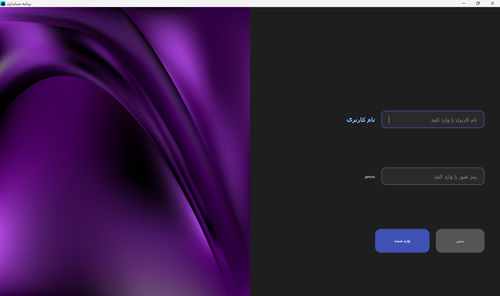</td>
    <td align="center">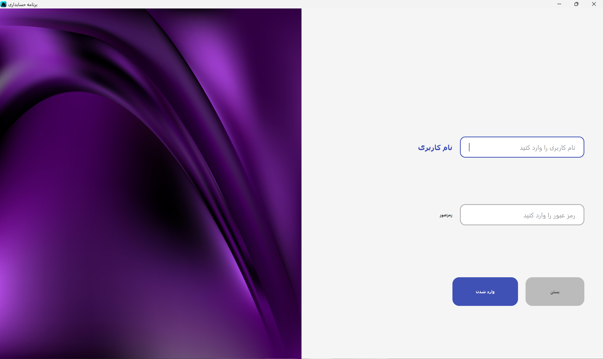</td>
  </tr>
  <tr>
    <td align="center">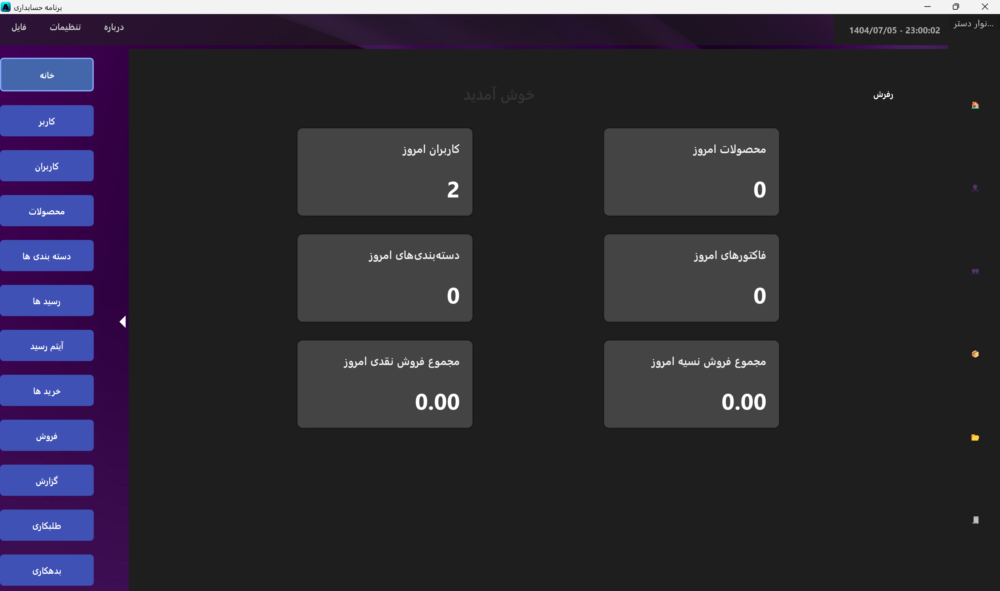</td>
    <td align="center">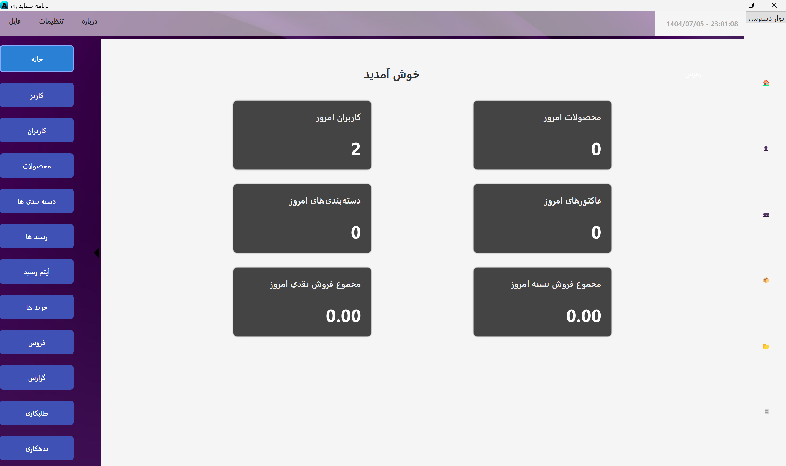</td>
  </tr>
  <tr>
    <td align="center">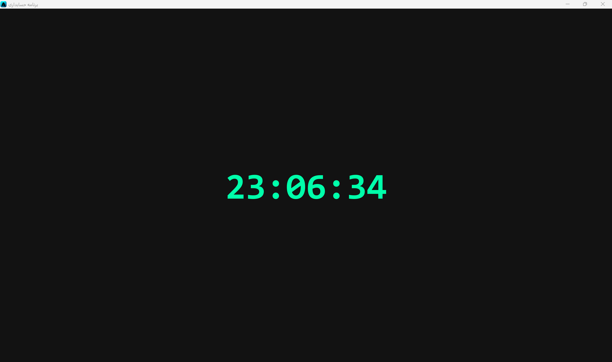</td>
   <td align="center">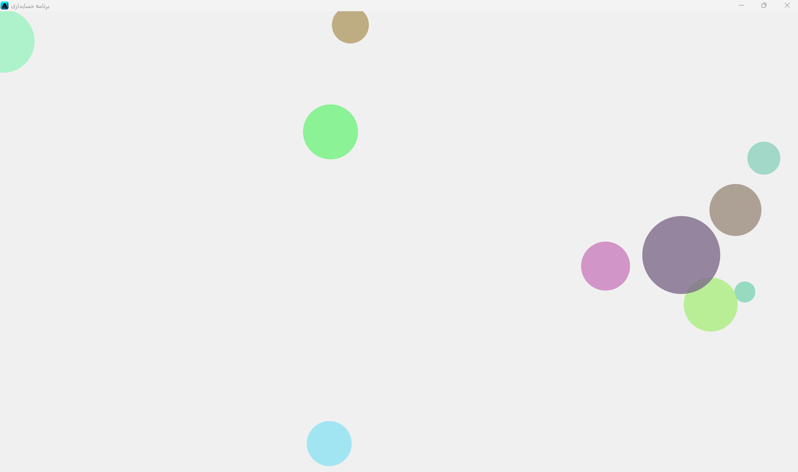</td>
  </tr>
  <tr>
    <td align="center">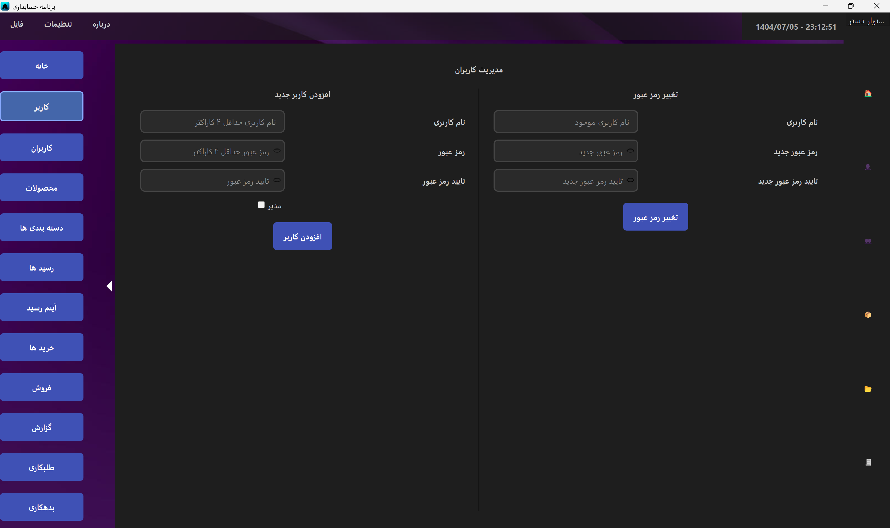</td>
    <td align="center">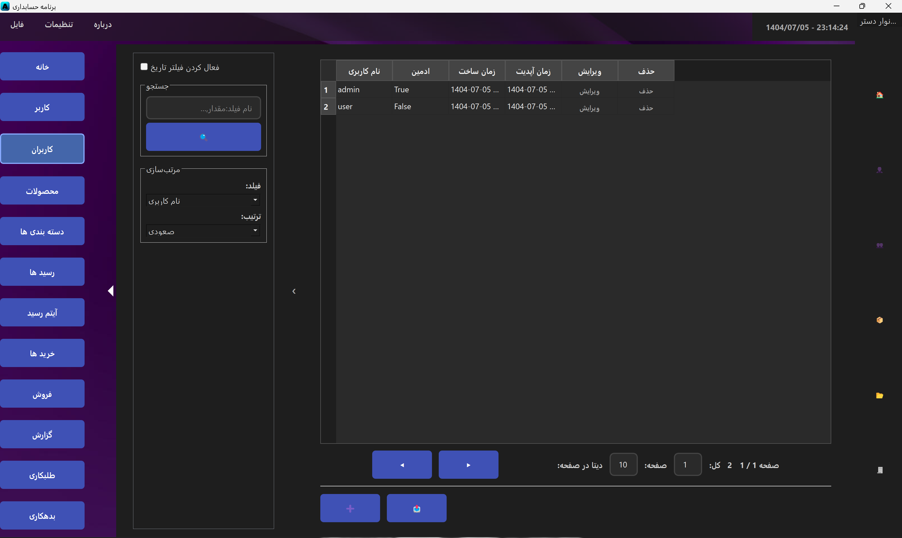</td>
  </tr>
  <tr>
    <td align="center">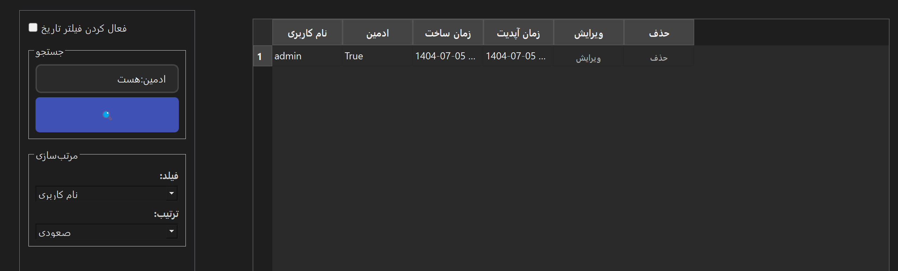</td>
    <td align="center">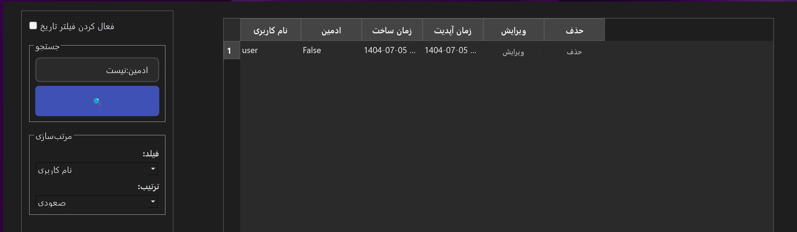</td>
  </tr>
  <tr>
    <td align="center">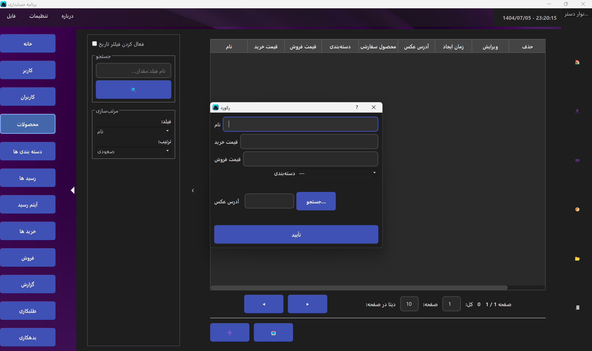</td>
    <td align="center">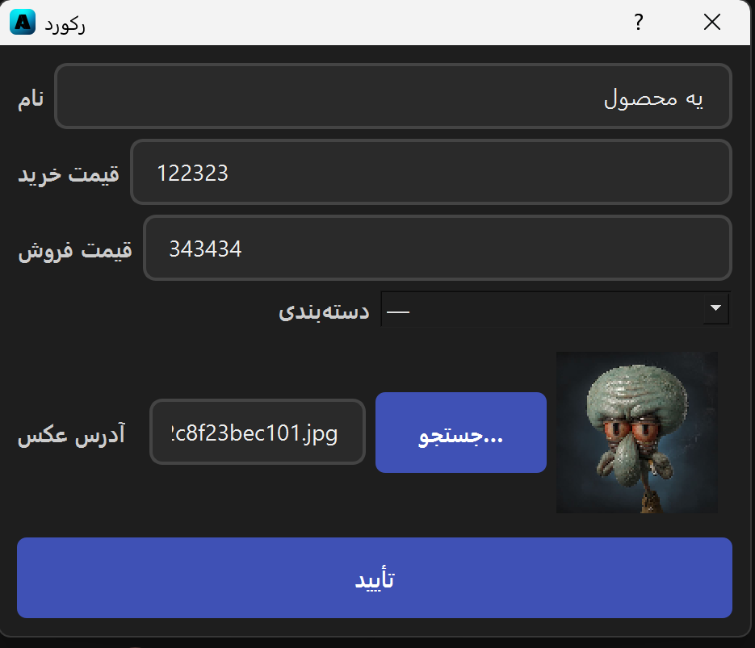</td>
  </tr>
  <tr>
    <td align="center">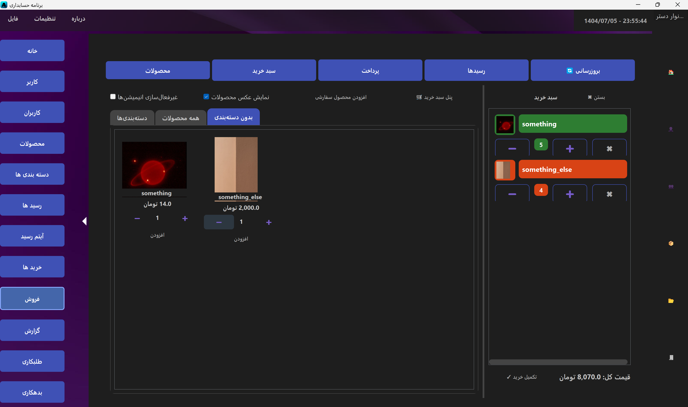</td>
    <td align="center">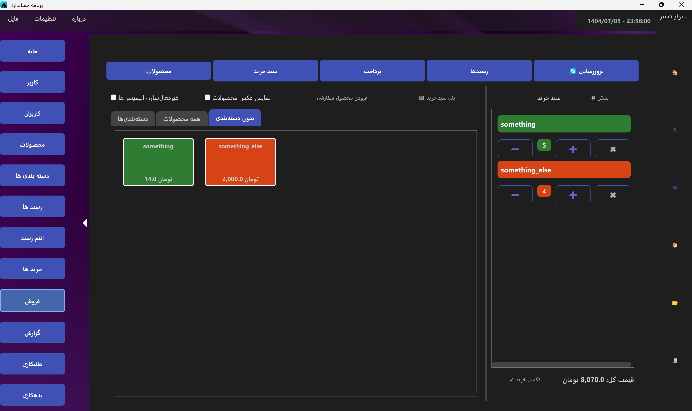</td>
  </tr>
  <tr>
    <td align="center">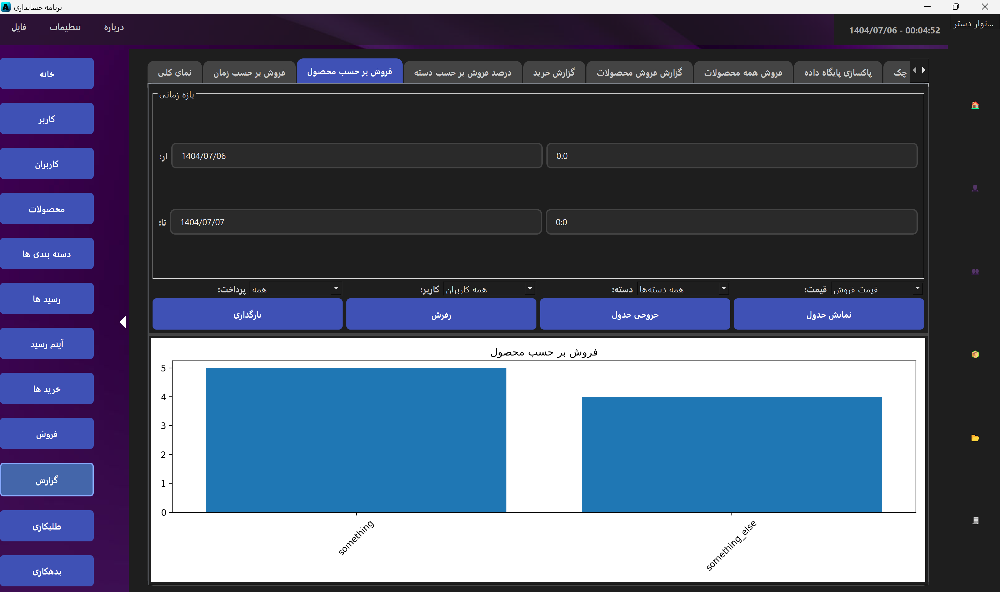</td>
    <td align="center">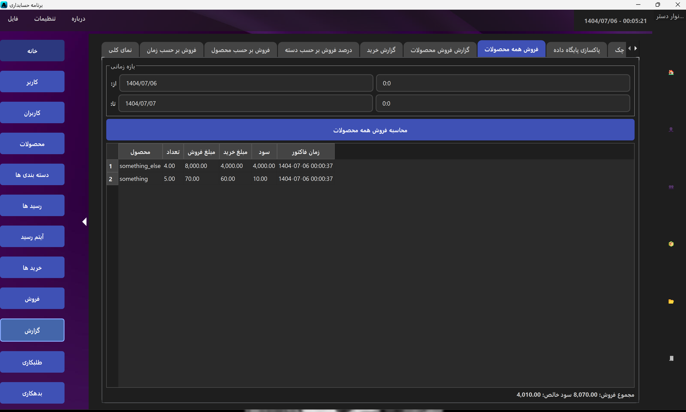</td>
  </tr>
</table>

